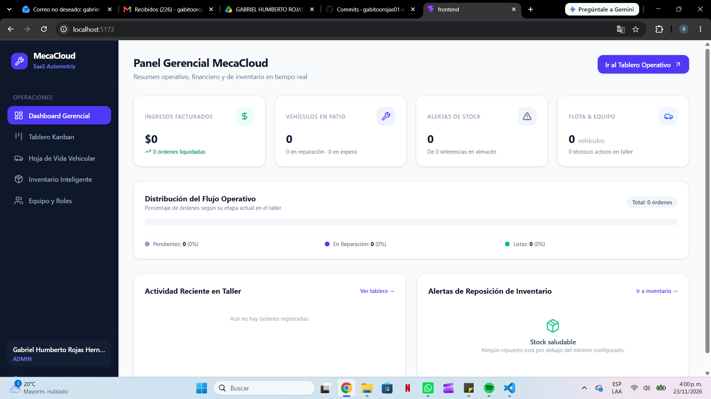

# 🔧 MecaCloud SaaS — Gestión Operativa Inteligente para Talleres Automotrices


**MecaCloud SaaS** es una plataforma web Full-Stack en la nube diseñada para digitalizar, automatizar y controlar de extremo a extremo la operación diaria de talleres automotrices y centros de servicio técnico. Elimina el uso de papel, centraliza el historial mecánico por placa y agiliza la comunicación directa con el cliente final.

---

## 🚀 Módulos Principales

1. **📊 Panel Gerencial en Tiempo Real:** Indicadores clave de desempeño (KPIs), ingresos facturados, órdenes activas, alertas de stock crítico y métricas operativas al instante.
2. **📋 Tablero Kanban Operativo:** Flujo visual de órdenes de trabajo (*Pendiente → En Diagnóstico → En Reparación → Listo / Entregado*), asignación de técnicos, notificación directa al cliente por **WhatsApp** y generación de **Factura / Orden en PDF**.
3. **🚗 Hoja de Vida Vehicular & Clientes:** Registro integral de propietarios y vehículos, trazabilidad histórica de mantenimientos, kilometraje y reparaciones por placa.
4. **📦 Inventario Inteligente:** Control de repuestos e insumos en tiempo real, alertas automatizadas de stock mínimo y **exportación de reportes a Excel (`.xlsx`)**.
5. **🔐 Equipo y Control de Acceso por Roles (RBAC):** Gestión de colaboradores con contraseñas cifradas mediante **BCrypt** y autenticación stateless con **JWT** bajo tres perfiles estrictos:
   * `ADMIN`: Control total, métricas financieras, inventario y gestión de usuarios.
   * `RECEPCION`: Registro de clientes/vehículos, apertura de órdenes, Kanban y facturación.
   * `MECANICO`: Visualización y actualización técnica de las órdenes asignadas.

---

## 📸 Capturas de Pantalla

### Panel Gerencial y Tablero Kanban

| Panel Gerencial (KPIs) | Tablero Kanban Operativo |
| :---: | :---: |
|  |  |

### Operación en Taller y Trazabilidad Vehicular

| Asignación de Mecánico | Hoja de Vida Vehicular | Registro Vehículo y Propietario |
| :---: | :---: | :---: |
|  |  |  |

### Gestión de Inventario y Administración de Equipo

| Inventario Inteligente | Registro de Repuestos | Equipo y Roles (RBAC) |
| :---: | :---: | :---: |
|  |  |  |

---

## 🏗️ Arquitectura y Stack Tecnológico

El sistema sigue una arquitectura cliente-servidor desacoplada y lista para despliegue en contenedores:

* **Backend:** Java 21, Spring Boot 4.1.2, Spring Security, Spring Data JPA / Hibernate, JWT (JSON Web Tokens), BCrypt, Apache POI (Exportación Excel) y OpenPDF / iText.
* **Frontend:** React, Vite, Tailwind CSS v4, Axios (con interceptores de seguridad) y Lucide Icons.
* **Base de Datos:** PostgreSQL 16.
* **Infraestructura & Despliegue:** Docker (`backend/Dockerfile`), configuración externalizada por variables de entorno y política CORS dinámica.

```text
MecaCloud-SaaS/
├── backend/          # API RESTful en Spring Boot + Dockerfile
├── frontend/         # SPA en React + Vite + Tailwind CSS v4
├── docs/             # Recursos visuales y capturas del sistema
└── README.md         # Documentación técnica y comercial
```

---

## ⚙️ Instalación y Ejecución Local

### Requisitos Previos
* **Java JDK 21** y **Maven 3.9+**
* **Node.js 20+** y **npm**
* **PostgreSQL 16** (o Docker)

### 1. Clonar el repositorio
```bash
git clone https://github.com
cd mecacloud-SaaS
```

### 2. Configurar y ejecutar el Backend
Crea una base de datos en PostgreSQL llamada `mecacloud_db` y configura tus variables de entorno (o `application.properties`):
```bash
cd backend
# Variables recomendadas: DB_URL, DB_USERNAME, DB_PASSWORD, JWT_SECRET, CORS_ALLOWED_ORIGINS
./mvnw spring-boot:run
```
El servidor iniciará por defecto en `http://localhost:8080`.

### 3. Configurar y ejecutar el Frontend
En una nueva terminal:
```bash
cd frontend
npm install
npm run dev
```
La aplicación web estará disponible en `http://localhost:5173`.

---

## 👨‍💻 Autor

**Gabriel Humberto Rojas Hernández**  
*Tecnólogo en Análisis y Desarrollo de Software (SENA) | Especialista en Infraestructura y Telecomunicaciones (+12 años de experiencia)*  
📍 Bogotá, Colombia  
🔗 GitHub: [@gabitoorojas01-arch](https://github.com)